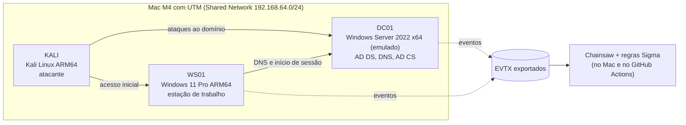

# Ribeira Purple Lab

Laboratório de Active Directory **como código** para praticar o ciclo completo de um teste de intrusão: **Atacar, Detetar, Corrigir, Provar**. Corre num único Mac com Apple Silicon e usa só ferramentas gratuitas.

> **Estado: semana 0 (teste de viabilidade).** Este repositório é o esqueleto: a estrutura, os modelos e os testes automáticos já estão prontos, e o conteúdo vai sendo preenchido semana a semana. O que ainda não está feito está por marcar na lista de entregáveis.


## A ideia numa frase

Monto uma empresa fictícia do Porto, a **Ribeira**, dentro do meu Mac. Ataco-a como um atacante que já entrou numa estação de trabalho, escrevo as regras que apanham cada passo, corrijo as falhas e provo, repetindo o ataque, que a correção funciona.

## Entregáveis

- [ ] **Laboratório como código** (`lab/`): três máquinas virtuais configuradas por Ansible, com as falhas propositadas registadas em [`docs/vulnerability-register.md`](docs/vulnerability-register.md).
- [ ] **Cadeia de ataque documentada** (`attack/`): do acesso inicial como utilizador sem privilégios até administrador do domínio, com a técnica MITRE ATT&CK, a evidência e a explicação de cada passo.
- [ ] **Deteção como código** (`detections/`): regras Sigma escritas por mim, testadas automaticamente contra eventos reais exportados do laboratório (GitHub Actions) e um mapa de cobertura no ATT&CK Navigator.
- [ ] **Correção e prova** (`hardening/`): uma correção por falha e a repetição do ataque a mostrar o antes e o depois.
- [ ] **Relatório de nível cliente** (`report/`): PDF com resumo executivo, achados com severidade (CVSS), evidência e remediação.

## Arquitetura



Detalhes, endereços e recursos de cada máquina em [`docs/architecture.md`](docs/architecture.md). A história da empresa e as regras do jogo estão em [`docs/scenario.md`](docs/scenario.md).

## Ferramentas (todas gratuitas)

| Função | Ferramenta |
| --- | --- |
| Virtualização | UTM |
| Controlador de domínio | Windows Server 2022, edição de avaliação (180 dias), emulado em x86_64 |
| Estação de trabalho | Windows 11 Pro ARM64 (ISO oficial da Microsoft) |
| Atacante | Kali Linux ARM64 (Impacket, NetExec, Certipy, BloodHound Community Edition) |
| Automação do laboratório | Ansible, a partir do Mac |
| Deteção | Sysmon, regras Sigma, Chainsaw, ATT&CK Navigator |
| Testes automáticos | GitHub Actions |
| Relatório | Markdown, convertido para PDF com Pandoc e Typst |

## Requisitos

- Mac com Apple Silicon e 16 GB de RAM (as três máquinas ligadas gastam cerca de 10 GB).
- Cerca de 120 GB livres em disco.
- Python 3.11 ou mais recente (no Mac: `brew install python@3.13`), Git e Make (`xcode-select --install`).
- Para gerar o PDF do relatório: `brew install pandoc typst`.

## Como reproduzir

```bash
make setup    # cria o ambiente Python (.venv) e instala o Ansible e as ferramentas de teste
make check    # valida o YAML, o playbook e as regras Sigma, e corre os testes de deteção
make help     # lista todos os comandos
```

Se o `python3` do teu Mac for antigo: `make setup PYTHON=python3.13`. A montagem das máquinas, passo a passo, está em [`lab/README.md`](lab/README.md).

## Estrutura

```text
docs/         arquitetura, cenário, registo de vulnerabilidades, registo da semana 0
lab/          Ansible (lab/ansible) e scripts PowerShell (lab/scripts)
attack/       cadeia de ataque, um ficheiro por passo (modelo em attack/_template.md)
detections/   regras Sigma, amostras de eventos e testes automáticos
hardening/    correções e re-testes
report/       modelo do relatório e PDF final
```

## Plano (4 semanas, cerca de 36 horas por semana)

Versão completa: 5 falhas propositadas e uma cadeia de ataque de 6 passos. São cerca de 144 horas, 18 delas de folga.

| Semana | Horas | Foco | No fim tem de existir |
| --- | --- | --- | --- |
| 1 | 33 + 3 de folga | Teste de viabilidade nos dois primeiros dias (semana 0) e depois o laboratório como código com Ansible | O plano A, B ou C decidido em [`docs/week-0-log.md`](docs/week-0-log.md). O Ansible monta o domínio do zero, com as 5 falhas registadas e aplicadas |
| 2 | 33 + 3 de folga | Cadeia de ataque documentada, 6 passos | `attack/AT-01` a `AT-06`, cada um com comandos, evidência e técnica ATT&CK, e os eventos exportados |
| 3 | 30 + 6 de folga | Deteção como código e testes automáticos; começam as correções | 5 a 6 regras Sigma com casos de teste, `make check` a passar e uma ficha de correção por falha |
| 4 | 30 + 6 de folga | Correção e prova, relatório, vídeo de 3 minutos e README final | O ataque falha depois da correção. Relatório em PDF, vídeo e README prontos |

**Pontos de controlo:** no fim de cada semana confirmo a última coluna da tabela. Se faltar algo, aplico logo o corte seguinte, sem esperar pela semana seguinte.

**Cortes, por esta ordem, se atrasar:**

1. Sai o AD CS (bónus) e o que depende dele: ficam 5 passos e 4 falhas.
2. Versão núcleo: 4 passos e 3 falhas.
3. Versão mínima: 3 passos e 2 falhas.

No quarto dia da semana 4 o âmbito congela: só falta provar e escrever. O plano ajusta-se ao resultado do teste de viabilidade (ver [`docs/week-0-log.md`](docs/week-0-log.md)).

## Aviso legal

Tudo o que está neste repositório foi feito e testado num laboratório próprio, isolado e sem ligação a sistemas de terceiros. Em Portugal, o acesso ilegítimo a sistemas informáticos é crime (artigo 6.º da Lei do Cibercrime, Lei n.º 109/2009). Usa estas técnicas apenas no teu laboratório ou em alvos com autorização escrita e âmbito explícito.

## Licença

Código e documentação sob licença MIT (ver [`LICENSE`](LICENSE)). Os ISOs e as ferramentas de terceiros não estão incluídos nem são redistribuídos: cada um tem a sua licença. O Chainsaw (GPL-3.0) é descarregado só na altura de correr os testes.
