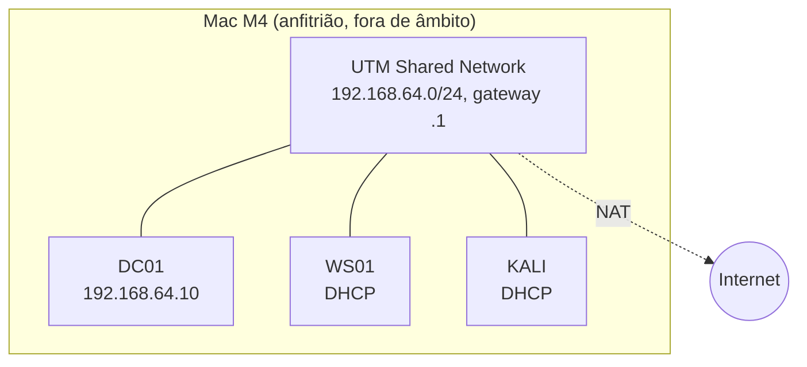
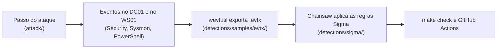

# Arquitetura do laboratório

## Máquinas

Três máquinas virtuais no mesmo Mac (Apple M4, 16 GB de RAM), geridas com o [UTM](https://mac.getutm.app). Os valores são o ponto de partida da semana 0; ajustam-se conforme o resultado dos testes de velocidade.

| Máquina | Sistema | Função | RAM | CPUs | Disco máx. | Endereço |
| --- | --- | --- | --- | --- | --- | --- |
| DC01 | Windows Server 2022 Standard (avaliação, x64, modo Core), **emulado** | Controlador de domínio (AD DS e DNS) e autoridade de certificação (AD CS) | 3 GB, mais 1 GB de cache JIT | 3 | 60 GB | 192.168.64.10 (fixo) |
| WS01 | Windows 11 Pro ARM64 | Posto de trabalho de um funcionário; é daqui que o atacante parte | 4 GB | 2 | 64 GB | automático (anota-o) |
| KALI | Kali Linux ARM64 | Máquina do atacante | 2 GB | 2 | 40 GB | automático (anota-o) |

Com as três ligadas gastam-se cerca de 10 GB e sobram cerca de 6 GB para o macOS. O DC01 é o mais pesado porque o Windows Server para ARM não existe: a Microsoft só disponibiliza a versão x64, que o UTM tem de **emular** (mais lenta). Por isso o DC01 usa 3 CPUs (nunca tantas como os núcleos de desempenho do M4) e a cache JIT do emulador a 1024 MiB.

## Rede

- As três máquinas estão na rede partilhada do UTM (NAT). Vêem-se umas às outras e saem para a internet; a rede de casa ou da escola não consegue iniciar ligações para elas.
- Depois de tudo instalado, podes mudar as placas de rede para **Host Only** no UTM e o laboratório fica sem internet durante os ataques. Volta a Shared Network quando precisares de atualizações.
- O DNS do domínio é o próprio DC01 (127.0.0.1), com o 1.1.1.1 como reencaminhador para a internet. O WS01 usa o DC01 como DNS; sem isso não consegue juntar-se ao domínio.
- O Kerberos recusa ligações se os relógios diferirem mais de 5 minutos. Se o Kali falhar a autenticar, acerta a hora (`sudo ntpdate <endereço do DC01>`).

## Domínio

| | |
| --- | --- |
| Nome DNS | `ribeira.test` (o sufixo `.test` está reservado e nunca existe na internet) |
| Nome NetBIOS | `RIBEIRA` |
| Autoridade de certificação | `Ribeira-CA` (empresa, raiz, RSA 2048, SHA-256, 5 anos): bónus da semana 0 |
| Unidades organizacionais | Administracao, Financeiro, RecursosHumanos, Comercial, TI |

Os utilizadores e grupos criam-se com o Ansible (`lab/ansible/roles/ad_objects`); a lista está em `lab/ansible/group_vars/all.yml`. Todos os nomes são inventados.

## De onde vêm os eventos

- As auditorias necessárias (Kerberos, serviços de diretório, certificados, criação de processos com linha de comandos, blocos de scripts PowerShell) ativam-se na role `common` do Ansible.
- O Sysmon (Sysinternals, gratuito) é opcional e instala-se à parte, com uma configuração pública à tua escolha. Não é copiado para este repositório.

## Cópias limpas

Antes de cada ataque e no fim de cada passo bem-sucedido, desliga a máquina e clona-a no UTM. Os clones do UTM são cópias completas (ocupam espaço): apaga as que já não precisares.

| Cópia | Quando |
| --- | --- |
| `DC01-limpo` | Domínio criado, sem certificados |
| `DC01-com-CA` | Domínio e autoridade de certificação |
| `WS01-limpo` | No domínio, ainda sem atividade do atacante |
| `KALI-limpo` | Ferramentas instaladas |

## Planos alternativos

Se o DC01 emulado for lento de mais (critérios no [`week-0-log.md`](week-0-log.md)):

- **Plano B, Samba AD:** um Debian ou Ubuntu ARM64 com o Samba como controlador de domínio. Não há emulação, por isso é rápido, mas perdes a autoridade de certificados e os eventos do Windows no controlador; a deteção passa a olhar para o WS01.
- **Plano C, outro computador:** pedir ao ISTEC um PC x86 emprestado, ou confirmar se tens acesso a créditos Azure for Students (a elegibilidade não foi verificada).
